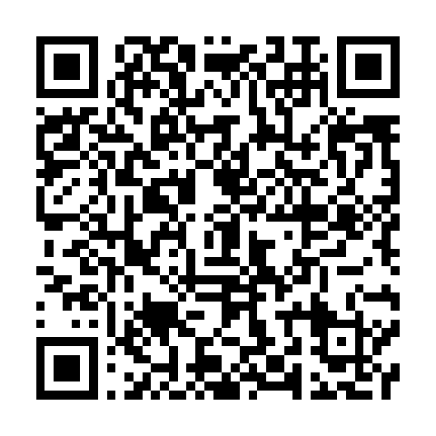

# The Legend of Zelda: Majora's Mask N64 3DS Port

A fan-made **native** Nintendo 3DS port of The Legend of Zelda: Majora's Mask (N64, US), built from the
[zeldaret/mm](https://github.com/zeldaret/mm) decompilation. It continues
[Andresac90's Majora's Mask 3DS port](https://github.com/Andresac90/MM-64-3DS-Port) (through
[casrielasriel's fork](https://github.com/casrielasriel/MM-64-3DS-Port) of it), which grew out of Andresac90's
[Ocarina of Time 3DS port](https://github.com/Andresac90/OOT-64-3DS-Port). This release finishes it: the bugs that kept
the game from being played through are fixed, and it is polished and extended (see Features).

> **Status: first release.** The whole game is playable. A New 3DS is recommended: it runs at 60 fps. An Old 3DS
> runs it too, but slows down in large areas such as Clock Town (see [Known issues](#known-issues)).

## Features

- **60 fps** on New 3DS (Settings > Frame rate: 20 or 60 fps)
- **Widescreen**, with the HUD at the screen edges if you like
- **Bottom screen**: touch buttons for the C items, the ocarina, the map and the pause tabs. Rather play without it?
  Gameplay > **Bottom screen** OFF turns it dark; tap it to turn it back on
- **D-pad items** like Project Restoration: transformation masks and the ocarina on the D-pad
- **Gyro aiming** and **C-Stick camera** (New 3DS)
- **Stereoscopic 3D** (work in progress)
- **Quality-of-life options** (Gameplay tab), many modelled on [2Ship2Harkinian](https://github.com/HarbourMasters/2ship2harkinian):
  fast text, skip cutscenes, instant put-away, arrow cycling with R, keep owl saves, save on pause, Double Time hour,
  fast chests, faster songs, fast rupee counting, faster transitions and transformations, no Blast Mask wait,
  faster climbing and block pushing, ocarina underwater, side roll and crouch stab, owl warp from the pause screen,
  Sun's Song, Takkuri can't steal, no final-day earthquakes, wide actor culling, **actor draw distance** (2x to 5x)
  and inverted first-person aiming (up/down, left/right)
- **HUD size** (70% to 130%) and a **CRT filter** (scanlines, light or strong) in the Gameplay tab
- **Cheats** tab (all off by default)
- Your own HOME Menu icon and banner picture: put `icon.png` and/or `banner.png` next to the builder before building
  (they go in your own `mm.cia`; the shareable `mm_romfree.cia` always keeps the port's own icon and banner)

## Controls

| 3DS | Game |
|---|---|
| A / B | A / B |
| Y / X | C-Left / C-Right |
| D-Pad Up | Goron Mask |
| D-Pad Down | Deku Mask |
| D-Pad Left | Zora Mask |
| D-Pad Right | Ocarina |
| ZR + D-Pad Up (New 3DS) | Fierce Deity's Mask (where the game allows it) |
| L | Z-target |
| R | Shield |
| SELECT | N64 L (map) |
| START | START |
| ZL (New 3DS) | C-Down |
| ZR (New 3DS) | Mask slot (a mask you assign on the pause screen; it goes on when you let go of ZR) |
| C-Stick (New 3DS) | Camera (or the four C buttons: Settings > C-Stick) |
| Touch screen | C items, ocarina, map, pause tabs |

The D-pad layout follows [Project Restoration](https://github.com/leoetlino/project-restoration) for Majora's Mask 3D.
While the ocarina staff or a message is on screen, the D-pad is the four C buttons, so you can play notes with it.
Prefer the D-pad as C buttons everywhere (handy on an Old 3DS, which has no ZL or C-Stick)? Turn on
Gameplay > **D-pad C buttons**.

## How to install

You need a 3DS with [Luma3DS](https://3ds.hacks.guide/) and FBI, and **your own** Majora's Mask ROM (N64, **US**
version), dumped from your own cartridge (`.z64`, `.n64` or `.v64`).

1. Install `mm_romfree.cia`: in FBI choose **Remote Install > Scan QR Code** and scan this code (it always gets the
   latest release), or download `mm_romfree.cia` from the [Releases](../../releases) page, copy it to your SD card and
   install it with FBI.

   
2. Copy your ROM to your SD card, into the folder `sdmc:/3ds/mm/`.
3. Start the game from the HOME Menu. The first start prepares your ROM and loads the game's data from it, which takes a
   moment; after that it starts normally.
4. No sound? Run the DSP1 homebrew once to dump your DSP firmware, then start the game again.

`mm_romfree.cia` contains **none** of the game's data: every texture, model, sound and line of text comes from your own
ROM when the game starts. Without your ROM it does nothing.

## Build it yourself

If you'd rather build everything on your own PC (Windows):

1. Install WSL with Ubuntu: open PowerShell as administrator, run `wsl --install -d Ubuntu`, restart, then open
   Ubuntu once to create a username and password.
2. Download `BUILD_MM3DS.bat` and `build_mm3ds.sh` from the [Releases](../../releases) page and put them in one
   folder together with your ROM.
3. Double-click `BUILD_MM3DS.bat`. The first build installs the tools and extracts the game data from your ROM,
   which takes 20 to 60 minutes. Later builds take a few minutes.
4. When it finishes, open the `output` folder next to the builder:
   - copy `baserom-decompressed.z64` to your SD card at `sdmc:/3ds/mm/baserom-decompressed.z64`
   - copy `mm.cia` to your SD card and install it with FBI

`mm.3ds` (also in `output`) runs in the Azahar emulator, with `baserom-decompressed.z64` in Azahar's `sdmc/3ds/mm/`
folder. Your own `mm.cia`, `mm.3ds` and `baserom-decompressed.z64` contain the game's data: keep them to yourself.

## Known issues

- Pressing HOME during play can, now and then, freeze the game (the game's `boot.log` in `sdmc:/3ds/mm/` records where;
  please attach it to a bug report).
- The audio can stutter now and then.
- Old 3DS: large areas such as Clock Town run well below full speed.
- Stereoscopic 3D is still a work in progress.

Please report bugs on the [Issues](../../issues) page, with a photo or video if you can, and say which 3DS model,
frame rate and settings you use.

## Legal

This project is not affiliated with, endorsed by, or sponsored by Nintendo.

- This repository contains source code, build scripts and tools only. It does **not** contain a ROM,
  extracted game assets, or any other Nintendo data. Nintendo, Nintendo 3DS, *The Legend of Zelda* and
  *Majora's Mask* are trademarks of Nintendo; all game content belongs to Nintendo.
- The game data always comes from **your own ROM**: `mm_romfree.cia` loads it from your ROM when the game starts,
  and the builder extracts it on your own computer. The only installer published here is `mm_romfree.cia`, which
  contains no game data. Please do not upload builds that do (`mm.cia`, `mm.3ds`).
- You must own the game: dump the ROM from your own cartridge. Do not ask for or share ROMs in this
  repository's issues.
- This is a non-commercial fan project, provided as is, without warranty of any kind.

## Credits

- [zeldaret/mm](https://github.com/zeldaret/mm): the Majora's Mask decompilation this port is built on. Its
  original README is kept in [docs/DECOMP_README.md](docs/DECOMP_README.md).
- [Andresac90](https://github.com/Andresac90): started the [Majora's Mask N64 3DS port](https://github.com/Andresac90/MM-64-3DS-Port)
  and wrote its 3DS foundation - the renderer, the citro3d backend, audio and the platform layer the game runs on -
  much of it brought over from his [Ocarina of Time 3DS port](https://github.com/Andresac90/OOT-64-3DS-Port).
- [casrielasriel](https://github.com/casrielasriel): the [fork](https://github.com/casrielasriel/MM-64-3DS-Port) of it
  (world rendering, input, saving, audio and running on real hardware) that this release builds on.
- [2Ship2Harkinian](https://github.com/HarbourMasters/2ship2harkinian) (HarbourMasters): many of the Gameplay options
  are modelled on its enhancements.
- [Project Restoration](https://github.com/leoetlino/project-restoration) (leoetlino): the D-pad item layout.
- The renderer (`port/src/gfx`) builds on the Super Mario 64 PC port's renderer and on
  [libultraship](https://github.com/Kenix3/libultraship).
- [devkitPro](https://devkitpro.org/): devkitARM, libctru and citro3d. `port/src/gfx3ds/c3d_fast.c` is an altered
  version of two citro3d source files, marked as such per citro3d's license.
